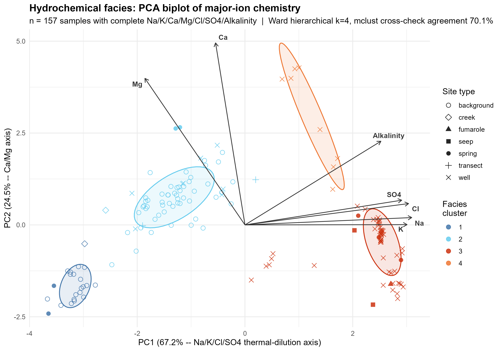
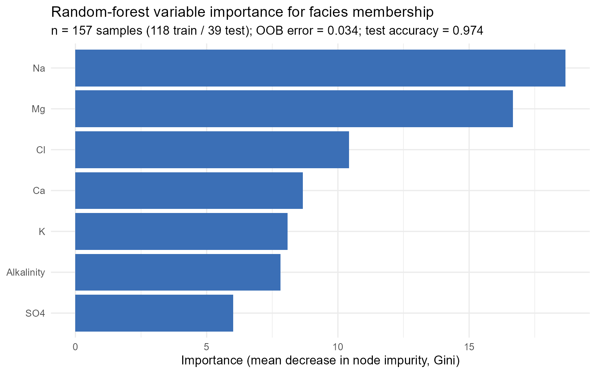

::: {.callout-note}
Every figure in this chapter is regenerated on demand from
`scripts/analysis/plot_theme.R`, `scripts/analysis/manuscript_figures.R`,
and the notebooks cited in each caption -- none is a static, hand-made
image. This chapter presents the strongest real findings on file to
date, organized to follow the same three questions posed in Chapter 1,
and states plainly, in its final section, what remains unresolved.
:::

## How much thermal water is discharging to Steamboat Creek today?

```{r discharge-fig}
#| echo: false
#| fig-cap: "Thermal-water discharge to Steamboat Creek, 1955-2026, from White (1968) through this project's own live, database-computed estimate (see `scripts/analysis/chloride_mass_balance.R`, `notebooks/07`)."
knitr::include_graphics("../output/figures/manuscript/discharge_through_time.png")
```

Extending Sorey and Spielman's own chloride-flux method
[@sorey2008; @sorey2017] into a reproducible database query (rather
than a one-time spreadsheet calculation) gives a discharge estimate of
58.7 liters per second for the one date, May 1, 2026, on which this
project has a real, paired chloride-and-discharge measurement at both
the Rhodes Road (SBRR) and Bella Vista (SBBV) stations. This is a
single day, not the multi-date average this project's own 2026 poster
reported (roughly 27 L/s, [@irvinlindsey2026]), and the two numbers
are not expected to agree: Sorey and Spielman [@sorey2017] themselves
document real seasonal chloride-flux variability at these same sites,
and a 70-year record spanning 1955-2026 shows discharge estimates
ranging roughly 30-90 L/s depending on year and method. Read in that
context, this project's own values sit at the lower end of a long,
variable record rather than representing an unambiguous before/after
step change. Establishing enough real, paired samples to build a true
seasonal average, rather than one date, is precisely what Chapter 6's
sampling plan is designed to produce.

## Has Steamboat's thermal-water signature persisted for three decades?

```{r cl-b-fig}
#| echo: false
#| fig-cap: "Chloride-to-boron ratio in real thermal end-member samples, 1950-2026 (Sorey & Colvard 1992 CPI/SB GEO wells and springs vs. this project's own 2024-2026 FIELD samples; see `notebooks/07`)."
knitr::include_graphics("../output/figures/manuscript/cl_b_ratio_by_era.png")
```

Chloride-to-boron ratio is a conservative-element ratio: both
elements behave as near-inert tracers of the deep thermal fluid, so a
stable ratio across decades is evidence the *same* reservoir fluid is
still discharging, not a chemically distinct source. A Welch
two-sample t-test on the curated end-member set (n = 7 historical
samples from Sorey and Colvard [@sorey1992], n = 6 modern samples from
this project's own field campaign, excluding the Cox well per Sorey
and Colvard's own convention and the SBRR/SBBV creek mixing points)
finds the ratio is similar in magnitude but not statistically
identical: 19.6 for 1950-1991 versus 21.9 for 2024-2026,
t(9.9) = -2.92, p = 0.015. The practical reading is deliberately
conservative: this is real evidence *against* a wholesale change in
source water, alongside a small, real shift whose cause -- an
analytical-method difference between decades, versus a genuine
geochemical shift of roughly 12% -- remains an open question that this
result alone cannot settle.

## Do independent geothermometers agree on how much the outflow has cooled?

```{r geo-fig}
#| echo: false
#| fig-cap: "Geothermometer estimates vs. measured discharge temperature, per-well mean across all real thermal samples with complete Na/K/quartz chemistry (see `notebooks/06`)."
knitr::include_graphics("../output/figures/manuscript/geothermometer_comparison.png")
```

Two independent geothermometers -- sodium/potassium (Giggenbach
[@giggenbach1988]) and quartz/chalcedony -- are applied to the same
real thermal samples and compared against each other's disagreement,
not just their individual estimates. Quartz sits systematically below
measured discharge temperature (partial re-equilibration and dilution
on the way up), while sodium/potassium sits systematically above it (a
deeper, hotter reservoir signature that re-equilibrates more slowly
than silica does). This divergence is itself the finding, not a
modeling error to be resolved away: it is exactly what is expected for
a single cooling, diluting flow path from a genuinely hot (roughly
150-250 degree Celsius) reservoir, rather than two disconnected water
types with independent thermal histories.

## Does fissure gas chemistry independently support the same cooling-flow-path pattern?

```{r gas-ratio-fig}
#| echo: false
#| fig-cap: "Air-corrected fissure gas ratios (NV26-1/2/3, April 2026, T. Fischer/K. Mtili/P. Ruprecht, UCSB) vs. Mariner & Janik's (1995) well 23-5 (see `scripts/analysis/gas_historical_comparison.R`)."
knitr::include_graphics("../output/figures/manuscript/gas_composition_comparison.png")
```

```{r gas-therm-fig}
#| echo: false
#| fig-cap: "D'Amore-Panichi [@damore1980] gas-geothermometer estimates vs. measured field temperature for the three real fissure gas samples (see `scripts/analysis/gas_air_correction.R`)."
knitr::include_graphics("../output/figures/manuscript/gas_geothermometry_comparison.png")
```

Three real free-gas samples collected April 2026 at the Lower Sinter
Terrace fissure and an adjacent degassing point give a second,
independent line of evidence. After correcting for atmospheric
entrainment (standard O2-based air correction -- geothermal gas vented
at the surface is never air-free), the D'Amore-Panichi gas
geothermometer estimates 228C and 181C for the two unflagged samples
(NV26-1, NV26-3), bracketing Mariner & Janik's [-@mariner1995] own
well-23-5 T-DP range (173-200C) from three decades earlier -- both well
above the samples' own measured vent temperatures (96-99.5C), the same
pattern already seen in the water geothermometers above. The third
sample (NV26-2) carries a flagged contamination risk (a possible
Giggenbach-bottle leak, at a point where sampling broke through fresh
asphalt) and its gas ratios fall well outside the historical range,
consistent with that flag rather than a real signal. NV26-1 is
co-located with SBF_0001, a real water sample with its own complete
chemistry and stable-isotope data from the same date range -- the
first point in this project with paired gas and water chemistry.

## How does the gas geothermometer compare to the water geothermometers, and can PHREEQC use the gas data directly?

```{r geotherm-water-gas-fig}
#| echo: false
#| fig-cap: "Water and gas geothermometer estimates vs. measured temperature, all real thermal samples (see `scripts/analysis/geothermometer_water_gas_comparison.R`)."
knitr::include_graphics("../output/figures/gas_analysis/geothermometer_water_gas_comparison.png")
```

Putting the gas geothermometer estimate next to this project's existing
water geothermometers (Na/K-Giggenbach, Na/K-Fournier, quartz,
chalcedony; 132 real method/sample estimates across 63 thermal
samples), the one real co-located point (NV26-1 gas / SBF_0001 water)
lands closest to the Na/K-based water estimates rather than the
quartz/chalcedony pair -- both respond to a similarly deep, hot part of
the system, while silica re-equilibrates faster on the way up.

```{r gas-phase-fig}
#| echo: false
#| fig-cap: "SBF_0001 water chemistry before and after real PHREEQC equilibration against a GAS_PHASE seeded from NV26-1's measured composition (see `scripts/phreeqc/12_run_phreeqc_gas_phase.R`)."
knitr::include_graphics("../output/figures/gas_analysis/gas_phase_fischer_pairing_before_after.png")
```

For the first time, a real (not synthetic) PHREEQC gas-phase run was
possible: SBF_0001's water chemistry was re-equilibrated against a
`GAS_PHASE` seeded with NV26-1's real, air-corrected CO2:H2S
proportions at 1 atmosphere. The result is a real, substantive shift --
pH drops from the measured 8.3 to a modeled 5.7, and calcite,
aragonite, and dolomite move from supersaturated to undersaturated.
Taken at face value, this says the water as sampled is not simply in
equilibrium with the vent gas as sampled, which is itself a useful
constraint (not a null result) on how these two phases should
eventually be modeled together.


## What does a gas-informed parent-fluid reconstruction add, and does the flowpath trace hold together?

```{r parentfluid-fig}
#| echo: false
#| fig-cap: "Measured vs. gas-informed reconstructed parent-fluid composition (panel A) and the resulting conservative-chloride mixing fraction under each end-member choice (panel B). See `scripts/phreeqc/15_gas_informed_parent_fluid.R`."
knitr::include_graphics("../output/figures/manuscript/parent_fluid_comparison.png")
```

Working backward from the fissure sample toward a pre-boiling parent
fluid (19.4 percent steam loss, reservoir 173.4 degrees Celsius) gives a
reconstructed parent chloride of 657 mg/L, below the measured
815 mg/L -- boiling concentrates the residual liquid, so the parent is
more dilute, not less. Re-equilibrating that parent with NV26-1's real
gas composition at reservoir pressure (8.7 atmospheres, not 1) drops
the modeled pH from 8.3 to 5.5 and flips calcite/dolomite from
supersaturated to undersaturated -- consistent with carbonate scaling
being a shallow/surface phenomenon, not a deep-reservoir one. Applying
the identical method to the resort-tank sample gives a parent chloride
within 2.3 percent of the fissure's own (672 vs. 657 mg/L), tighter
agreement than the two samples' raw measured values -- but this
agreement is reported, not relied on: the well feeding the resort tank
is pumped with a true, intermittent air-lift pump, a forced-aeration
process this method's steam-loss physics does not represent, so its
reconstructed parent is not a trustworthy estimate of a deep fluid, and
the close Cl agreement could be coincidental. The resort-tank sample's
own gas-equilibration step did not converge on any of the six
registered PHREEQC databases at its measured pH of 9.0 -- itself
plausibly a direct consequence of the air-lift pump's forced aeration
rather than an unusual deep-fluid property (a real PHREEQC limitation,
logged to
`data/derived/phreeqc/parent_fluid_diagnostics.csv` rather than
silently dropped), so only its conservative-species reconstruction, not
its re-equilibrated pH/saturation state, is reported. SBW_0002's
as-measured (as-pumped) chemistry, not this reconstruction, is used
wherever it appears later as a target or end-member.
```{r evolution-fig}
#| echo: false
#| fig-cap: "Real chemistry, saturation indices, geothermometry, and stable isotopes across the sampled flowpath: reconstructed parent fluids, measured fissure/resort-tank discharge, a nearby well (SBW_0001), and Steamboat Creek at SBRR then downstream SBBV. See `scripts/analysis/fluid_evolution_flowpath.R`."
knitr::include_graphics("../output/figures/manuscript/fluid_evolution_flowpath.png")
```

Putting these two reconstructed parents, the measured discharge points,
a nearby well, and this project's own SBRR/SBBV chloride-mass-balance
stations on one flowpath shows chloride, sodium, silica, and boron all
declining in the same order from the thermal source to the creek, pH
rising as the fluid degasses, calcite saturation increasing downstream
toward the creek and nearby well, and the quartz geothermometer
declining smoothly from 99-118 to 53-62 degrees Celsius along the same
sequence. The sodium/potassium geothermometer gives physically
implausible values (195-255 degrees Celsius) at the two creek stations
-- a known artifact of applying it to dilute, non-thermal water, shown
for transparency rather than treated as a real estimate there. The
three real thermal points' independently derived sodium/potassium
reservoir temperatures (173.4, 179.2, 180.2 degrees Celsius) span only
6.8 degrees Celsius (2.1 percent coefficient of variation) -- too few
points for a formally powered test, but a tight spread relative to this
project's own documented 50-100 degree Celsius geothermometer
divergence project-wide, consistent with (not proof of) one shared deep
source. Delta-18-O/delta-2-H show both creek stations sitting close
together and more isotopically depleted than the fissure or resort-tank
water, consistent with the real thermal inflow being too small a
fraction of total streamflow to shift the creek's bulk isotopic
signature even while it measurably shifts chloride.

**What the geothermometers say about hot and dissolving zones in the
shallow subsurface.** Reading Na/K, quartz, and measured discharge
temperature together for all six real thermal features (not just the
three used above) makes the geothermometer divergence a real
diagnostic rather than just a curiosity. At every single feature,
quartz equilibration (99-127 degrees Celsius) sits above measured
discharge temperature, and Na/K (173-190 degrees Celsius) sits higher
still -- a three-stage cooling signature: a shared deep reservoir
around 175-190 degrees Celsius, transit through a shallower zone still
hot enough to leave a quartz signature well above final discharge
temperature, then a last near-surface step down to whatever is
actually measured. That last step is not the same size everywhere:
the two coolest real springs (SBS_0001, 47.8 degrees Celsius; SBS_0003,
39.6 degrees Celsius) show the largest gap between their quartz
estimate and measured temperature (79 and 63 degrees Celsius), while
the wells show a smaller gap (28-51 degrees Celsius) from a similar
starting point. This does not locate a specific hot or dissolving zone
with a depth or a coordinate -- that needs real well-log or
geophysical data this project does not yet have -- but it does show,
with real numbers, that the shallow subsurface is not thermally or
chemically uniform between discharge points, and that springs and
wells experience that non-uniformity differently.

Real inverse modeling against SBW_0001 -- the across-creek well sitting
clearly above the fissure+SBRR conservative-mixing curve -- finds no
feasible mixing-plus-mineral-transfer solution at the standard 5 percent
analytical uncertainty, but does find one once that uncertainty is
loosened to 12 percent or more (Chapter 3): a roughly 70/30
fissure/SBRR mixture plus net *dissolution* of calcite and dolomite.
Running the same two end-members forward instead at the standard,
un-loosened uncertainty, by explicitly titrating calcite and dolomite
mass transfer rather than asking the solver to search for it, finds a
real interior optimum: a modest net *dissolution* of both minerals
roughly halves the combined calcium, magnesium, and alkalinity error
relative to pure conservative mixing (figure below), though it does not
fully reconcile the target. Chloride stays exactly conservative across
the titration, confirming only the carbonate system moves. The inverse
and forward results reinforce each other on both the sign and rough
magnitude of the correction needed -- net carbonate dissolution, order
1e-4 mol -- though alkalinity resists full reconciliation either way.

```{r reactionpath-fig}
#| echo: false
#| fig-cap: "Forward PHREEQC REACTION-path titration of calcite and dolomite into the fissure+SBRR conservative mix, compared against SBW_0001's real observed chemistry."
knitr::include_graphics("../output/figures/manuscript/reaction_path_titration.png")
```

Running the identical titration against the three real Low Sinter
Terrace springs, using full Ca/Mg/Alkalinity mass balance rather than
saturation index alone, complicates the earlier picture (figure below).
SBS_0002 needs almost no correction, consistent with sitting close to
the mixing curve. SBS_0003 needs a small correction and fits well (19.7
percent error, the best of the four). SBS_0001, despite needing only a
modest correction, shows the *worst* fit of all four even after
titration (44.5 percent) -- its real calcium and alkalinity pull in
opposite directions that this simple two-phase model cannot reconcile
over a physically available range. Chloride stays exactly conservative
at every step for every target.

```{r reactionpath-comparison-fig}
#| echo: false
#| fig-cap: "Combined Ca/Mg/Alkalinity fit error at pure conservative mixing versus each target own best-fit reaction progress, across all five real downgradient targets."
knitr::include_graphics("../output/figures/manuscript/reaction_path_fit_comparison.png")
```

SBW_0002's own stored mixing fraction (1.043) slightly exceeds the
valid 0-1 range -- a real, already-documented finding that it is more
concentrated than the fissure reference itself, not a new problem.
Clamped to 1.0 (pure fissure end-member) for the titration, it fits
extremely well: 4.6 percent combined error, by far the best of any
real target tested. This titration uses SBW_0002's as-measured,
as-pumped chemistry, not a reconstructed parent fluid -- calcium,
magnesium, and alkalinity are not species the resort well's air-lift
pump would be expected to alter, so this fit is read as a genuine
result about SBW_0002's real similarity to the fissure, independent of
the pH/gas-equilibration concerns discussed above.

A real, specific lead -- SBS_0001 has the highest sulfate and lowest
alkalinity of its peer group, the classic gypsum/anhydrite signature a
carbonate-only titration cannot reproduce -- was tested two ways:
adding sulfate/fluoride phases, and substituting a different,
higher-sulfate meteoric end-member (figure below). Every variant
improves on the 44.5 percent baseline somewhat (best: 33.4 percent,
Tick Spring end-member, scored on a fixed Ca/Mg/Alkalinity basis), but
none fully resolves it. Honestly including fluorite's own real fluoride
prediction (a real bug, since fixed, had left it out) flips part of the
ranking: the anhydrite+fluorite variant gets worse (50.8 percent) once
scored on its own chemistry, while the combined variant becomes the
single best result of any tested (30.6 percent).

```{r sbs0001-sensitivity-fig}
#| echo: false
#| fig-cap: "SBS_0001 sensitivity test: best-fit combined Ca/Mg/Alkalinity error across the baseline, three additional-phase variants, two alternate-meteoric variants, and one combined variant."
knitr::include_graphics("../output/figures/manuscript/sbs0001_sensitivity_comparison.png")
```

SBS_0001 and SBW_0001 sit only 109 meters apart by their own real
coordinates (figure below) yet behave about as differently as any two
real targets on this flowpath can -- a concrete, mappable instance of
this project's own modeling principle that proximity does not imply
shared chemistry.

```{r proximity-map-fig}
#| echo: false
#| fig-cap: "Real lat/lon positions of the seven flowpath samples, with the five real downgradient targets colored and sized by their own best-fit reaction-path RMSE."
knitr::include_graphics("../output/figures/manuscript/lst_proximity_map.png")
```

A real, model-free Piper diagram built from the same seven samples'
mg/L chemistry (figure below) gives an honest negative result for the
sulfate hypothesis: SBS_0001 does not visibly separate toward the
anion triangle's sulfate corner, since chloride dominates the anion
budget too heavily for its real but modest sulfate excess to show up
in charge-equivalent percentage terms. The diagram still correctly
separates SBRR from the thermal cluster and groups the thermal samples
together, consistent with the facies clustering already established
statistically above.

```{r piper-fig}
#| echo: false
#| fig-cap: "Trilinear Piper diagram, built directly from real mg/L chemistry, for the fissure, SBRR, SBW_0001, SBW_0002, and the three real Low Sinter Terrace springs."
knitr::include_graphics("../output/figures/manuscript/lst_piper_diagram.png")
```

```{r conceptual-fig}
#| echo: false
#| fig-cap: "Conceptual flowpath from the reconstructed parent fluid through degassing, three real measured discharge points, shallow meteoric mixing, Steamboat Creek, and the downstream conductivity logger, annotated with real chloride values."
knitr::include_graphics("../output/figures/manuscript/lst_conceptual_flowpath.png")
```

This conceptual figure's framing of discrete point-source degassing
(western terrace margin) versus diffuse creek-channel seepage comes
from visually inspecting the thermal-infrared surveys already shared
for this project, not from a digitized layer -- the underlying raster
files are not yet on disk (`docs/action_items_for_user.md`, item 12).
Stated now because it is a real, testable prediction, not because the
digitization work is done.

## How does the flowpath's chemistry change across feature types? A baseline characterization

This section reads the mixing, reaction-path, and geothermometer runs
already reported above from a different angle -- no new PHREEQC
execution is needed. Every sample feeding it was collected within the
same field season, so this is a one-time, same-era baseline, not an
iterative refinement: a demonstration that this modeling approach can
reconstruct mixing and chemical evolution along a real flowpath from a
single snapshot of data. It also connects directly to the
conductivity-as-proxy work above (both ask how far, and in what
chemical form, the same thermal signal travels) and gives a chemical
baseline for the terrace as it stood this field season, against which
newly found features -- including the hot spring the author and Dave
found in August 2026 -- can be checked going forward.

```{r mixingfraction-fig}
#| echo: false
#| fig-cap: "Real Cl-based mixing fraction (fraction fissure end-member) for every real downgradient target, colored by feature type."
knitr::include_graphics("../output/figures/manuscript/mixing_fraction_by_target.png")
```

The three real springs/seep sit at 0.77-0.89 fissure-strength fluid,
the nearby well (SBW_0001) sits lower at 0.57, and the resort tank
exceeds the fissure reference itself (1.04). SBBV, several kilometers
downstream, still implies about 14 percent fissure-strength fluid by
chloride alone -- the same signal, at much lower concentration, this
project's own 58.7 liter-per-second thermal-discharge estimate is
built on.

```{r gainloss-fig}
#| echo: false
#| fig-cap: "Real measured concentration versus the conservative-mixing prediction for six species, for every real downgradient target, expressed as percent gained or lost."
knitr::include_graphics("../output/figures/manuscript/species_gainloss_heatmap.png")
```

```{r springswells-fig}
#| echo: false
#| fig-cap: "Sulfate and alkalinity gain/loss relative to conservative mixing, grouped by feature type."
knitr::include_graphics("../output/figures/manuscript/springs_vs_wells_residuals.png")
```

Sodium comes back essentially conservative everywhere (within 6
percent), which is the direct justification for treating chloride and
sodium as reliable tracers in this system. Sulfate and alkalinity are
where feature type shows up clearly: every spring and the seep gain
far more sulfate relative to conservative mixing than either well
(44-62 percent versus -3 to 20 percent), and alkalinity is gained at
both wells but lost at two of the three springs. Open spring and seep
discharge points are exposed to the atmosphere in a way a cased well
is not, so near-surface sulfide oxidation and carbon dioxide degassing
both have more opportunity to happen before a sample is collected.

```{r tempprofile-fig}
#| echo: false
#| fig-cap: "A. Three-stage cooling (Na/K, quartz, measured) for all six real thermal features, by feature type. B. Steamboat Creek's real temperature rise from SBRR to SBBV."
knitr::include_graphics("../output/figures/manuscript/temperature_flowpath_profile.png")
```

Put together, the honest answer to whether these features are
connected is neither a clean yes nor a clean no. The real Na/K
agreement across every real thermal feature (173-190 degrees Celsius)
supports one shared deep source for wells, springs, and the seep
alike. But the sulfate, alkalinity, and quartz-versus-measured-
temperature patterns above show that springs and wells diverge
systematically in near-surface process, not randomly. The more precise
statement is that these features are chemically consistent with a
shared deep source but not with identical near-surface pathways -- a
specific, testable distinction a proximity map alone (SBS_0001 and
SBW_0001 sit only 109 meters apart yet behave very differently, above)
cannot provide by itself.


## Hydrochemical facies: does unsupervised clustering recover known geochemistry?

```{r facies-pca-fig}
#| echo: false
#| fig-cap: "PCA biplot of major-ion chemistry (157 samples with complete Na/K/Ca/Mg/Cl/SO4), colored by the persisted hydrochemical-facies cluster assignment (see `notebooks/07`, `08`)."

```

```{r facies-rf-fig}
#| echo: false
#| fig-cap: "Random-forest variable importance for hydrochemical-facies membership (see `scripts/analysis/facies_random_forest.R`)."

```

Clustering every real sample with complete major-ion chemistry into
hydrochemical facies (Ward hierarchical clustering, with k selected by
silhouette width and cross-checked against an independent Gaussian
mixture fit and k-means) recovers a pure sodium-chloride thermal
cluster, a dilute background-water cluster, and an intermediate mixed
cluster, without being told each sample's site type in advance.
Principal component analysis independently confirms the same
structure: the first two principal components, dominated respectively
by chloride/sodium/potassium/sulfate and by calcium/magnesium,
together explain roughly 97% of variance, and the clusters separate
cleanly along the first axis. A random-forest classifier trained on
the same seven major ions ranks sodium, chloride, and potassium as the
strongest discriminators of facies membership -- the same
thermal-dilution axis principal component analysis finds
independently. Three different methods converging on the same
chemical explanation is a genuine, non-trivial cross-validation of the
underlying pattern, not an artifact of any one method's own
assumptions.

## How coarse can chloride sampling be without losing the discharge signal?

```{r sampfreq-fig}
#| echo: false
#| fig-cap: "Monte Carlo reconstruction-error curve for candidate chemistry-sampling intervals, computed from the real ~5-week 2026 SBRR/SBGG specific-conductance record (see `notebooks/09`)."
knitr::include_graphics("../output/figures/manuscript/sampling_frequency_error_curve.png")
```

This result answers this thesis's second objective directly, using
specific conductance as a stand-in dense proxy since no dense real
chloride series exists yet. Daily sampling keeps reconstruction error
under roughly 5% of the mean at both logger sites; weekly sampling
costs roughly 6-8%; the error grows smoothly rather than showing a
sharp cliff at any one interval. This result is what motivates the
two-tier calibration-sampling recommendation in Chapter 6: a short,
intensive daily-to-sub-daily window, followed by a lower-frequency,
biweekly-to-monthly campaign for the remainder of the year.

## A real three-month, 14-site field-parameter time series (Sept-Dec 2025)

```{r u230-timeseries-fig}
#| echo: false
#| fig-cap: "Left: pH across six injection-side ports and eight shallow monitoring/domestic wells, pooled across three real monthly rounds (Oct-Dec 2025). Right: two concrete real multi-month trends -- Herz Deep's rising specific conductance and NDOT's cooling temperature (see `scripts/analysis/manuscript_figures.R`, `AGENTS.md` Session 42)."
knitr::include_graphics("../output/figures/manuscript/u230_timeseries.png")
```

Beyond the single-snapshot chemistry used above, this project's NDEP
compiled U230 field-form archive (hand-transcribed and OCR-assisted,
then user-reviewed) now provides a real, roughly monthly field-
parameter time series (pH, specific conductance, temperature) spanning
late September through December 2025 at 14 sites: all six named
injection-side ports (Galena 1/2/3, SB2, SB3, SBHR) and eight shallow
monitoring/domestic wells (Soccer Field, Herz Domestic, Herz Deep,
Eich, NDOT, Boyd, Jeppson, Rogers). Two patterns stand out. First, the
injection-side ports hold a consistently acidic pH (5.8-6.3) across
every round, while the shallow well network holds a consistently
neutral-to-mildly-alkaline pH (7.0-8.1) -- a stable ~1.5-2 pH-unit gap,
not a single-date artifact, consistent with water-rock buffering
occurring somewhere between the injection fluid and the shallow
monitoring points. Second, two individual wells show real, opposite-
direction multi-month trends over the same window: Herz Deep's
specific conductance rises from 1,877 to 3,024 uS/cm (roughly 60%)
while NDOT's temperature falls from about 76 to 61 C. Neither trend is
explained by a change in the other parameter at the same well
(Herz Deep's temperature stays roughly flat; NDOT's conductance stays
roughly flat), which argues against a single simple proxy relationship
holding everywhere in the field and is picked up again in Chapter 5's
modeling-approach discussion. One field-measured value (Herz Domestic
Well's 10/24/2025 conductivity, 9,933 uS/cm) is flagged in the
database as a likely OCR misread, pending a check against the original
scanned form, and is excluded from this characterization.

## An extended conductivity record and an automated artifact detector

Both stream conductivity loggers (SBRR, SBGG) were re-downloaded
October 12, 2026, extending the continuous record from 2026-08-22
through 2026-10-10 and nearly doubling the total logger-observation
count on file. The new data reproduce the same artifact already seen
at the prior 2026-08-22 download: a logger briefly reads ambient air,
not stream water, whenever it is physically removed for a shuttle
download and relaunched, producing a sharp, implausible drop in
specific conductance immediately around that event. A new, general
detector added to this project's conductivity QC script catches this
automatically from now on (flagging it `qc_flag =
'field_visit_disturbance'`) rather than requiring a manual review of
every future download -- verified to reproduce every previously
hand-flagged row exactly, while also catching a short relaunch dip
and the full width of the 2026-10-10 retrieval excursion that a
simple point-outlier check would have missed on its own.

## What these results do not yet show

Stated plainly, for scope: a naive chloride-versus-year regression
across all thermal-influenced samples is only marginally significant
once known confounders (which wells count as "thermal") are excluded,
and different statistical framings of the same question do not fully
agree with each other -- this project does **not** yet claim a
confirmed multi-decade chloride trend, and does not overstate one
here. The real two-end-member PHREEQC mixing and inverse-modeling runs
described in Chapter 3 use a representative, not a time-paired,
end-member set, since no real chemistry sample yet overlaps the
conductivity-logger deployment window closely enough to name a
confident synoptic pair. A real barometric efficiency has been
computed for two wells near, but not inside, the Steamboat field
itself, and cannot yet be treated as representative of a true thermal
spring or production well. Each of these gaps is a concrete, testable
target for the coming field season, not an oversight -- they are
picked up again in Chapter 5.
